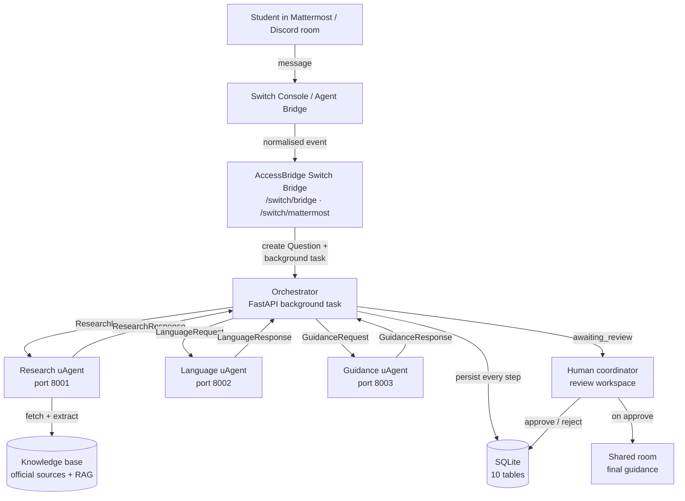
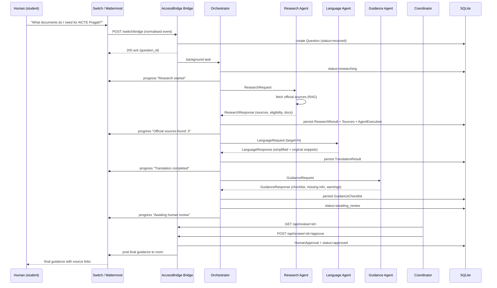

<div align="center">

# AccessBridge AI

### Making essential information understandable and accessible to everyone.

A multi-agent, source-backed guidance system for scholarships and educational
opportunities — built with **Fetch.ai uAgents**, **Switch**, **FastAPI** and
**React**.

**Languages:** English · हिन्दी · ਪੰਜਾਬੀ

</div>

---

## 1. Project description

AccessBridge AI turns complicated scholarship and public-service information
into understandable, source-backed guidance. A student asks a question in a
shared communication room (Mattermost or Discord). Three independent Fetch.ai
uAgents — **Research**, **Language** and **Guidance** — research official
sources, simplify and translate the information, and build a personalised
application checklist. A human coordinator reviews the result before it is
delivered back into the room.

It is not a chatbot. It is a team of specialist agents and a human, working
through a real communication platform, with every claim tied to a source URL
and a retrieval timestamp.

## 2. Problem statement

Students and underserved communities routinely struggle with:

- **Complicated eligibility requirements** buried in long PDFs and notifications.
- **Government websites with difficult language** — formal, jargon-heavy, often
  written for administrators rather than applicants.
- **Information scattered across multiple websites** — a single scholarship may
  require reading a notification, an FAQ, a portal help page and a state
  government order.
- **Confusing application procedures** with no clear checklist of documents
  or steps.
- **Language barriers** — most official information is in English only.
- **Unverified information and misleading AI answers** — generic chatbots
  hallucinate deadlines, amounts and eligibility conditions with confidence.

## 3. Solution

AccessBridge AI is a multi-agent workflow with a human review gate:

1. A student asks a question in a shared room routed through **Switch**.
2. The **Research Agent** retrieves curated official sources, extracts
   eligibility / documents / deadlines / steps, and cites every URL with a
   retrieval timestamp.
3. The **Language Agent** simplifies the official wording and translates it
   into English, Hindi or Punjabi — preserving exact official wording for
   important conditions.
4. The **Guidance Agent** builds a personalised application checklist, flags
   missing information and unanswered eligibility questions, and prepares the
   response for human review.
5. A **human coordinator** reviews the sources, the extracted fields and the
   translated guidance, then approves, rejects, or requests corrections.
6. Only after approval is the **final guidance** posted back into the shared
   room, with source links and clear uncertainty warnings.

The MVP focus is **education, scholarships and student opportunities**. It
does not attempt to cover every government service.

## 4. Why AccessBridge matters

A wrong scholarship deadline or an invented eligibility condition is not a
minor bug — it can cost a student an entire academic year of support.
Generic chatbots are trained to be helpful, not to be right about
public-service facts. AccessBridge is built on the opposite premise: **reliability
matters more than impressive answers.**

Every fact carries a source. Every source carries a timestamp. Every
uncertainty is named. Every important answer is checked by a human before it
reaches a student.

For underserved communities — first-generation applicants, students whose
first language is Hindi or Punjabi, students without a family member who has
navigated these schemes before — this is the difference between applying and
not applying.

## 5. Screenshots

> Screenshots are captured from the running application and added here before
> submission. The UI is an editorial, premium-public-interest design — deep
> ink/navy on warm off-white, with a restrained accent palette. No fake
> statistics, no glowing cards, no AI-robot illustrations.

```
docs/screenshots/landing.png        — landing page (hero + workflow engine)
docs/screenshots/dashboard.png      — main dashboard (real backend data)
docs/screenshots/ask.png            — Ask AccessBridge question interface
docs/screenshots/agents.png         — agent workspace (3 agents, real traces)
docs/screenshots/review.png         — human review workspace
docs/screenshots/final-guidance.png — final approved guidance page
docs/screenshots/mattermost.png     — message flow in Mattermost room
```

## 6. Main features

- **Three independent Fetch.ai uAgents** with separate responsibilities,
  structured Pydantic message protocol, and real `on_message` / `ctx.send`
  inter-agent communication.
- **Switch integration** via the Agent Bridge endpoint — Switch Console
  dispatches room messages to the orchestrator; raw Mattermost outgoing
  webhooks are also supported for local testing without the Switch Console.
- **Switch Trust guardrails** wrap every LLM call from every agent.
- **RAG knowledge base** of curated official scholarship sources (AICTE
  Pragati, AICTE Saksham, Post-Matric SC/OBC, Swami Vivekananda, NSP, UGC
  ISIR, Chevening, Commonwealth, Fulbright) with live HTTP fetch,
  BeautifulSoup extraction, retrieval timestamps, and honest `reachable=false`
  reporting when a source cannot be fetched.
- **Human review gate** — approve / reject / request corrections, with
  reviewer name, action and timestamp recorded.
- **Three languages** — English, Hindi, Punjabi — with original official
  wording preserved verbatim alongside the simplified explanation.
- **Audit logging** — every workflow transition is recorded.
- **Premium editorial UI** — calm, accessible, trustworthy; no AI-slop.
- **Voice-friendly chat input** — works with Wispr Flow / OS-level dictation;
  optional browser speech recognition with a text fallback.

## 7. Architecture diagram



## 8. Multi-agent architecture

AccessBridge uses **three real, independent Fetch.ai uAgents**. Each defines
its own `Agent`, its own `on_message` handler, and replies with a structured
`uagents.Model`. They are not three labels inside one LLM response.

| Agent | Port | Responsibility | Input | Output |
|---|---|---|---|---|
| **Research** | 8001 | Retrieve official sources, extract eligibility / documents / deadlines / steps, cite URLs | `ResearchRequest` | `ResearchResponse` |
| **Language** | 8002 | Simplify official wording, translate to en/hi/pa, preserve original snippets | `LanguageRequest` | `LanguageResponse` |
| **Guidance** | 8003 | Build a personalised checklist, flag missing info, prepare for review | `GuidanceRequest` | `GuidanceResponse` |

The orchestrator runs them in **embedded mode** by default (calls their pure
`research()` / `translate()` / `guide()` functions in-process, which is
deterministic and reliable for the demo). For genuine inter-process uAgents
messaging, run each agent as its own process via `scripts/run_agents.sh` and
use `agents.orchestrator.dispatch_distributed()`.

## 9. Fetch.ai uAgents explanation

Each agent module (`agents/research_agent.py`, `language_agent.py`,
`guidance_agent.py`) follows the same pattern:

```python
from uagents import Agent, Context
from agents.messages import ResearchRequest, ResearchResponse

agent = Agent(
    name="accessbridge-research-agent",
    seed=os.environ["ACCESSBRIDGE_AGENTS_SEED"],
    port=8001,
    endpoint=["http://localhost:8001/submit"],
)

@agent.on_message(model=ResearchRequest)
async def handle_research(ctx: Context, sender: str, msg: ResearchRequest) -> None:
    result = await research(msg)           # pure business logic
    await ctx.send(sender, result)         # structured Pydantic reply

if __name__ == "__main__":
    agent.run()
```

The message models (`agents/messages.py`) extend `uagents.Model`, so they can
travel over the Fetch.ai uAgents protocol directly. The same models are used
by the orchestrator in embedded mode, so the protocol is identical whether
the agents run in-process or as independent processes.

## 10. Switch integration explanation

Switch is integrated in two complementary ways, both real:

### Switch Console — Agent Bridge

The Switch Console (desktop app) lets you create an agent that points its
**bridge endpoint** at AccessBridge's `POST /switch/bridge` route. When a
human sends a message in a connected Mattermost or Discord room, Switch
dispatches a normalised JSON event to our bridge. The bridge verifies the
inbound token, creates a `Question` row, and schedules the orchestrator as a
FastAPI background task.

### Switch Trust — LLM guardrails

Every LLM call from every agent is wrapped with Switch Trust
(`backend/app/services/llm.py`). When `ACCESSBRIDGE_SWITCH_TRUST_API_KEY` is
set, calls go through the Switch Trust gateway under the configured policy.
When it is not set, the SDK runs in pass-through mode and logs a warning —
local development still works.

### Mattermost outgoing webhook (local testing without Switch Console)

`POST /switch/mattermost` accepts a raw Mattermost outgoing-webhook payload
(form-encoded or JSON). This lets the full workflow run with Mattermost alone
when the Switch Console is not yet configured.

The bridge **never hardcodes tokens**. The inbound token is read from
`ACCESSBRIDGE_SWITCH_BRIDGE_TOKEN` and verified on every request.

## 11. Communication workflow



### Suggested rooms

Create these channels in your Mattermost team (Switch Console maps them to
the agent):

- `#student-questions` — where students ask
- `#research-updates` — progress messages from the Research Agent
- `#translation` — Language Agent progress
- `#human-review` — coordinator review queue
- `#final-guidance` — approved answers

## 12. Technology stack

| Layer | Technology |
|---|---|
| Frontend | React 18, TypeScript, Vite, Tailwind CSS, Lucide icons, Framer Motion |
| Backend | Python 3.11+, FastAPI, Pydantic v2, SQLAlchemy 2 |
| Database | SQLite (MVP) |
| Agents | Fetch.ai uAgents |
| Communication | Switch (Console Agent Bridge + Switch Trust guardrails) |
| Chat platform | Mattermost (primary), Discord (alternative) |
| LLM | Any OpenAI-compatible endpoint (configurable) |
| Knowledge retrieval | httpx + BeautifulSoup, curated official sources |
| Testing | pytest, pytest-asyncio |
| Deployment | Docker, Docker Compose |

## 13. Installation

```bash
# 1. Clone
git clone https://github.com/<your-org>/accessbridge-ai.git
cd accessbridge-ai

# 2. Create a Python virtual environment
python -m venv .venv
source .venv/bin/activate          # Windows: .venv\Scripts\activate

# 3. Install backend dependencies
pip install -r requirements.txt

# 4. Install frontend dependencies
cd frontend && npm install && cd ..

# 5. Configure environment
cp .env.example .env
# Edit .env — at minimum set ACCESSBRIDGE_SWITCH_BRIDGE_TOKEN and
# ACCESSBRIDGE_REVIEW_APPROVAL_SECRET (see section 14).

# 6. Initialise the database (creates data/accessbridge.db with all tables)
python -c "from backend.app.database import init_db; init_db()"
```

## 14. Environment configuration

Every secret is read from an environment variable. Nothing is hardcoded. See
`.env.example` for the full list with comments. The most important ones:

| Variable | Purpose | Required? |
|---|---|---|
| `ACCESSBRIDGE_SWITCH_BRIDGE_TOKEN` | Token Switch presents when calling `/switch/bridge` | For Switch Console |
| `ACCESSBRIDGE_REVIEW_APPROVAL_SECRET` | Secret for approve/reject endpoints | Yes (for review) |
| `ACCESSBRIDGE_LLM_API_KEY` | OpenAI-compatible API key | Optional (deterministic fallback if empty) |
| `ACCESSBRIDGE_SWITCH_TRUST_API_KEY` | Switch Trust guardrails key | Optional (pass-through if empty) |
| `ACCESSBRIDGE_MATTERMOST_BOT_TOKEN` | Mattermost bot token | For room posting |
| `ACCESSBRIDGE_AGENTS_SEED` | Fetch.ai seed deriving agent addresses | **Change in production** |

Generate strong tokens with:

```bash
python -c "import secrets; print(secrets.token_urlsafe(32))"
```

## 15. Mattermost / Discord setup

### Mattermost (recommended)

1. Deploy or sign up for a Mattermost instance (cloud or self-hosted).
2. Create a team and the five channels listed in section 11.
3. Create a bot account: **System Console → Integrations → Bot Accounts**.
   Give it a token and add it to all five channels.
4. Set `ACCESSBRIDGE_MATTERMOST_BOT_TOKEN` and `ACCESSBRIDGE_MATTERMOST_BASE_URL` in `.env`.
5. (Alternative) For outgoing webhooks: **Integrations → Outgoing Webhooks**,
   point the callback URL at `http://<your-host>:8000/switch/mattermost`
   and set the same `ACCESSBRIDGE_SWITCH_BRIDGE_TOKEN` as the webhook token.

### Discord (alternative)

Discord integration follows the same bridge pattern. Set up a Discord
application at the Discord Developer Portal, add a bot, and route its
messages through the same `/switch/bridge` endpoint via the Switch Console.
See the Switch documentation at <https://docs.switchagents.ai> for the
current Discord adapter.

## 16. Switch setup

1. Install the **Switch Console** desktop app (see
   <https://docs.switchagents.ai>).
2. Create an agent in the Switch Console whose **bridge endpoint** is your
   AccessBridge `/switch/bridge` URL, e.g.
   `http://localhost:8000/switch/bridge`.
3. Set the bridge token to the value of `ACCESSBRIDGE_SWITCH_BRIDGE_TOKEN`.
4. Connect the agent to your Mattermost or Discord room.
5. (Optional) For Switch Trust guardrails, sign up at the Switch Trust
   gateway and set `ACCESSBRIDGE_SWITCH_TRUST_API_KEY` and
   `ACCESSBRIDGE_SWITCH_TRUST_POLICY_ID`.

Verify the bridge is reachable:

```bash
curl http://localhost:8000/switch/health
# {"bridge_enabled": true, "switch_trust": {...}, "mattermost_configured": ...}
```

## 17. Running the agents

The orchestrator runs the agents in embedded mode by default — no separate
processes are needed. To run them as **independent uAgent processes**
(demonstrating genuine inter-process messaging):

```bash
# In three separate terminals:
python -m agents.research_agent     # port 8001
python -m agents.language_agent     # port 8002
python -m agents.guidance_agent     # port 8003
```

Or use the helper:

```bash
bash scripts/run_agents.sh
```

Each agent prints its Fetch.ai address on startup. The orchestrator's
`dispatch_distributed()` sends real uAgents messages to these addresses.

## 18. Running the backend

```bash
# From the repository root, with .venv activated:
uvicorn backend.app.main:app --reload --port 8000

# Or:
python -m backend.app.main
```

Interactive API docs: <http://localhost:8000/docs>

## 19. Running the frontend

```bash
cd frontend
npm run dev        # starts Vite on http://localhost:5173
```

The frontend talks to the backend at `http://localhost:8000` by default
(see `frontend/src/services/api.ts` to override).

## 20. Running with Docker

```bash
# Build and run the whole stack
docker compose up --build

# Backend on :8000, frontend on :5173, three agent processes on :8001-8003.
```

See `docker-compose.yml` and `Dockerfile` for details.

## 21. Example workflow

A student in `#student-questions` types:

> "What documents do I need for the AICTE Pragati scholarship for girls? I am
> in my second year of a B.Tech and my family income is below 8 lakh."

What happens:

1. Switch delivers the message to `/switch/bridge`.
2. A `Question` row is created. Status → `researching`.
3. The Research Agent matches the AICTE Pragati source in the curated
   knowledge base, fetches it (or uses the bundled official excerpt if the
   network is unreachable), and returns a `ResearchResponse` with
   `scholarship_name`, `provider`, `eligibility` (8 items),
   `required_documents` (8 items), `application_deadline`, and 3 `sources`
   each with a URL + retrieval timestamp. `verification_status=partial`.
4. The Language Agent simplifies and returns both the simplified explanation
   and 4 original official snippets (preserved verbatim).
5. The Guidance Agent builds an 18-item checklist, flags 1 missing piece of
   information (e.g. "caste certificate not confirmed") and 1 uncertainty
   warning.
6. Status → `awaiting_review`. The coordinator opens the review workspace,
   reads the sources, the extracted eligibility, the translated guidance, and
   clicks **Approve**.
7. Status → `approved`. The final guidance is posted into `#final-guidance`
   with source links and the verification timestamp.

You can reproduce this from the API directly:

```bash
curl -X POST http://localhost:8000/api/questions \
  -H "Content-Type: application/json" \
  -d '{"question_text":"What documents do I need for AICTE Pragati?","language":"en","category":"scholarship"}'
```

## 22. Testing

```bash
# All tests
python -m pytest -v

# Unit tests for each agent
python -m pytest tests/unit -v

# Integration test for the full orchestrator workflow
python -m pytest tests/integration -v
```

Tests use an in-memory SQLite database and the deterministic fallback (no LLM
required), so they run in any sandbox.

## 23. Security and privacy

- **No secrets in the repository.** `.env` is git-ignored. The bridge token,
  review secret, LLM key, Mattermost token and Switch Trust key are all read
  from environment variables.
- **Token verification on every inbound bridge request.**
- **Review secret required** to approve or reject final guidance.
- **Rate limiting** on the question submission endpoint (default 60/min).
- **Upload cap** of 2 MB on optional document uploads.
- **Audit logging** — every workflow transition and review action is recorded
  with actor, event, payload and timestamp.
- **No unnecessary personal information collected.** A question needs only the
  question text, language and category. The student's chat identity is stored
  only if it arrives via Switch/Mattermost.
- **No automatic scholarship application submission.** AccessBridge produces
  guidance, never submits an application on a student's behalf.

## 24. Known limitations

- **Curated knowledge base.** The MVP ships with 10 curated official
  scholarship sources. Adding more is a matter of dropping a `.txt` file into
  `knowledge_base/data/` and registering it in `knowledge_base/sources.py`.
- **Offline fallback.** When a source page cannot be fetched live (network
  unreachable, SSL failure, etc.), the Research Agent uses a bundled official
  excerpt and records `reachable=false` so the UI can show the failure
  transparently. It never claims a live fetch when the information came from
  a cached excerpt.
- **Translation without an LLM** uses deterministic templates that preserve
  every official field but do not produce flowing prose. With an LLM key set,
  the Language Agent produces natural simplifications in en/hi/pa.
- **Distributed uAgents dispatch** sends real inter-agent messages but does
  not yet correlate responses by `question_id` asynchronously — the
  production path uses embedded mode for reliability.
- **Discord integration** follows the same bridge pattern as Mattermost but
  is not the primary tested path in this submission.

## 25. Future roadmap

- **More official sources** — state scholarship portals, university
  financial-aid pages, fellowship programmes.
- **Live source monitoring** — a scheduled job that re-fetches each source
  daily and flags when official wording has changed.
- **Document upload + extraction** — let a student upload their caste /
  income certificate and have the Guidance Agent verify eligibility fields
  against the extracted text.
- **Async distributed dispatch** — full `question_id`-correlated
  request/response over uAgents so the three agents can run on different
  machines.
- **More languages** — Urdu, Tamil, Telugu, Bengali.
- **Coordinator roles** — multi-tenant organisations with their own
  coordinators and source allow-lists.

## 26. Demo video

> _Placeholder — record the demo following `docs/DEMO_SCRIPT.md` and link it
> here before submission._
>
> `https://youtu.be/<your-demo-id>`

## 27. Hackathon submission information

- **Hackathon:** Flip the Switch
- **Project:** AccessBridge AI
- **Tagline:** Making essential information understandable and accessible to everyone.
- **Stack:** Fetch.ai uAgents + Switch + FastAPI + React + SQLite.
- **Languages:** English, Hindi, Punjabi.
- **MVP scope:** Education, scholarships and student opportunities.

See `BUILD_STATUS.md` for the phase-by-phase build log and the final
compliance report.

---

<div align="center">

Built for the Flip the Switch hackathon. Reliability over impressive answers.

</div>
