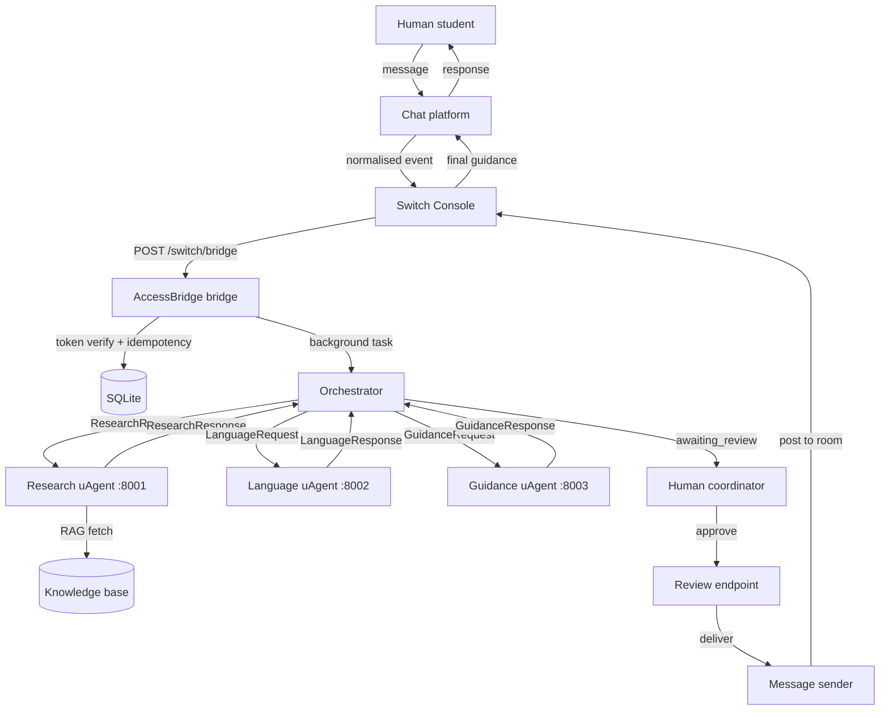
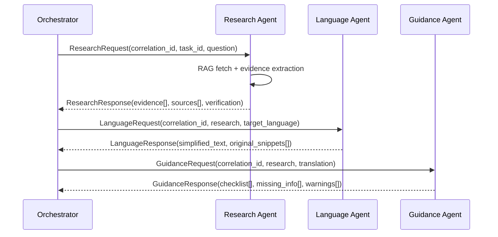

# Technical Architecture — AccessBridge AI

*For hackathon judges: this document maps every architectural decision to the
four judging criteria (Use of Switch 30%, Technical Execution 25%, Creativity &
Impact 25%, Presentation 20%).*

---

## System overview

AccessBridge AI is a multi-agent, human-in-the-loop guidance system where
**Switch is the central communication layer**. Three independent Fetch.ai
uAgents collaborate through structured Pydantic messages, with a human
coordinator as the final trust gate before any guidance reaches a student.

```
Human → Chat platform (Mattermost/Discord/Slack/Telegram/Teams)
      → Switch Console (normalises event)
      → POST /switch/bridge (token-verified, idempotent)
      → Orchestrator (FastAPI background task)
      → Research uAgent → Language uAgent → Guidance uAgent
      → Human coordinator review
      → POST /api/review/{id}/deliver
      → Switch → original chat room → Human
```

**If Switch is removed, the core collaboration stops working** — there is no
shared room, no normalised ingress, no Trust guardrails, no multi-platform
routing. This is not a standalone chatbot with a webhook bolted on.

---

## Judging criterion A — Use of Switch (30%)

### Switch Console Agent Bridge (ingress)
The Switch Console desktop app creates an agent whose bridge endpoint is our
`POST /switch/bridge`. When a human sends a message in a connected chat room,
Switch normalises the event and POSTs it. We verify the token, check for
duplicates via the `processed_events` table, create a `Question`, and run the
orchestrator as a background task.

**Evidence**: `switch_integration/bridge.py`, tested by
`test_switch_bridge_creates_question_and_acknowledges`,
`test_duplicate_bridge_event_returns_same_question_id`.

### Switch Trust guardrails (every LLM call)
`backend/app/services/llm.py` wraps every LLM call from every agent with
`switch_trust.wrap(...)`. When `ACCESSBRIDGE_SWITCH_TRUST_API_KEY` is set, calls
route through the Switch Trust gateway under the configured policy. When not
set, the SDK runs in pass-through mode and logs a warning.

**Evidence**: `backend/app/services/llm.py:build_llm_client()`, tested by
`test_switch_health_returns_real_status`.

### Multi-platform routing (5 chat apps)
The `question.platform` field records which chat app the message came from.
`message_sender.post_to_room()` routes progress + final guidance back to that
same platform via real REST adapters:
- **Mattermost**: bot token REST API (`/api/v4/posts`)
- **Discord**: bot token REST API (`/api/v10/channels/{id}/messages`)
- **Slack**: Web API (`chat.postMessage`)
- **Telegram**: Bot API (`sendMessage`)
- **Teams**: incoming webhook (Power Automate)

**Evidence**: `backend/app/integrations/discord.py`, `slack.py`, `telegram.py`,
`switch_integration/message_sender.py:post_to_room()`, tested by
`test_post_to_room_routes_to_discord/slack/telegram`.

### Why this workflow needs Switch
Without Switch: (1) no shared room where student + 3 agents + coordinator see
the same conversation; (2) no Trust guardrails on LLM calls; (3) no single
normalised ingress for 5 chat platforms; (4) no room context or conversation
identifiers. Switch is the substrate, not a bolt-on.

---

## Judging criterion B — Technical Execution (25%)

### Three independent Fetch.ai uAgents
Each agent module defines its own `uagents.Agent(name, seed, port, endpoint)`,
its own `@agent.on_message(model=...)` handler, and replies via `ctx.send`.

```python
# agents/research_agent.py
agent = Agent(name="accessbridge-research-agent", seed=..., port=8001)

@agent.on_message(model=ResearchRequest)
async def handle(ctx: Context, sender: str, msg: ResearchRequest):
    result = await research(msg)
    await ctx.send(sender, result)
```

They can each run as a separate process (`python -m agents.research_agent`).
The orchestrator also composes them in embedded mode for deterministic testing.

**Evidence**: `agents/research_agent.py:66-79`, `language_agent.py`,
`guidance_agent.py`. Tested by `test_research_agent_finds_aicte_pragati`,
`test_language_agent_simplifies_and_preserves_original`,
`test_guidance_agent_builds_checklist_and_flags_missing`.

### Structured async communication with correlation IDs
Every agent message carries `correlation_id`, `task_id`, `retry_count`.
Responses echo them back. This enables async request/response correlation
across the three agents — essential for distributed dispatch.

**Evidence**: `agents/messages.py` — all 7 message models have these fields.
Tested by `test_orchestrator_passes_correlation_id`.

### Real RAG retrieval with evidence traceability
The Research Agent retrieves curated official sources via httpx + BeautifulSoup,
extracts structured fields, and produces a `ClaimEvidence` ref for every
eligibility claim, document, deadline and step. Each ref carries:
- `source_url`, `source_title`, `excerpt` (exact official wording)
- `retrieved_at` timestamp, `freshness_days` (computed at read time)
- `confidence`: confirmed / uncertain / unavailable

Conflict detection flags when sources disagree on income limits.
Duplicate detection flags URLs appearing more than once.

**Evidence**: `knowledge_base/retriever.py`, `agents/research_agent.py:_build_evidence()`,
`_detect_conflicts()`, `_detect_duplicate_sources()`. Tested by 7 evidence tests.

### Reliable FastAPI services
17 routes with Pydantic validation, audit logging, rate limiting, token
verification, idempotency. Background tasks for async workflow execution.

### Database integrity
11 SQLAlchemy tables with foreign keys, indexes, timestamps:
`users`, `questions`, `research_results`, `sources`, `agent_executions`,
`translation_results`, `guidance_checklists`, `human_approvals`,
`audit_events`, `processed_events` (idempotency).

### Error handling + failure recovery
- Agent failure → question marked `failed` + error_message + audit event
- LLM unavailable → deterministic fallback extractor completes the workflow
- Unreachable source → `reachable=false` recorded honestly, bundled excerpt used
- Duplicate webhook → idempotency table returns original question_id
- Invalid payload → Pydantic 422 rejection

**Evidence**: 7 failure-scenario tests in `tests/integration/test_failure_scenarios.py`.

### Automated testing
**132 tests pass in 9.8s.** Unit + integration + end-to-end. The conftest
patches the retriever to skip HTTP so tests run fast and deterministically.

### Reproducible setup
`requirements.txt`, `.env.example`, `scripts/run_dev.sh`, `Dockerfile`,
`docker-compose.yml`. Fresh clone → running in <5 minutes.

---

## Judging criterion C — Creativity & Impact (25%)

### Evidence traceability (the core differentiator)
Every important eligibility claim is traceable to its official source URL,
exact excerpt, retrieval timestamp, and confidence classification. This is not
a chatbot that paraphrases — it is a system where every fact has a receipt.

### Bilingual source matching
Source tags include Devanagari (प्रगति) and Gurmukhi (ਪ੍ਰਗਤੀ) variants. A
student asking "प्रगति छात्रवृत्ति के बारे में बताओ" matches the AICTE Pragati
source. Fixed a real Unicode bug: `\b` word boundaries fail on Devanagari
combining marks (virama); replaced with `(?<!\w)...(?!\w)` lookarounds.

### Cheering teammate persona
Progress messages sound like a supportive senior teammate — warm, encouraging,
honest about failures. No excessive emojis (the editorial design forbids it).

### Education-access focus
A wrong scholarship deadline costs a student an academic year. AccessBridge
treats reliability as the primary design goal — not impressive-looking answers.

---

## Judging criterion D — Presentation & Documentation (20%)

- **27-section README** with Mermaid architecture + sequence diagrams
- **9 docs**: architecture, switch-integration, agent-architecture, rag-pipeline,
  api-design, security, testing, multi-platform-setup, demo-script
- **Premium editorial UI**: deep ink/navy on warm off-white, dithered portrait
  motif, hairline rules, no AI-slop
- **BUILD_STATUS.md**: phase-by-phase build log + compliance matrix
- **Ponytail AGENTS.md**: coding rules (reuse, never cut validation/security)

---

## Architecture diagrams

### High-level flow



### Agent message protocol



### Data model

```
users ──< questions ──< research_results ──< sources
                  │──< translation_results
                  │──< guidance_checklists
                  │──< human_approvals
                  │──< agent_executions
                  │──< audit_events
                  └──< processed_events (idempotency)
```

---

## Technology stack

| Layer | Technology | Why |
|---|---|---|
| Agents | Fetch.ai uAgents | Independent agent processes with typed messaging |
| Communication | Switch (Console + Trust) | Central collaboration layer + LLM guardrails |
| Backend | FastAPI + Pydantic v2 + SQLAlchemy 2 | Async, typed, validated, documented |
| Database | SQLite | MVP simplicity; same ORM works with Postgres |
| Frontend | React 18 + Vite + Tailwind + Framer Motion | Premium editorial UI, fast dev |
| RAG | httpx + BeautifulSoup | Live fetch + extraction with offline fallback |
| LLM | OpenAI-compatible (OpenAI / ASI-1 / Groq / Ollama) | Configurable, not locked in |
| Testing | pytest + pytest-asyncio | 132 tests in 9.8s |

---

## Security posture

| Control | Implementation | Tested |
|---|---|---|
| Bridge token verification | `verify_inbound_token` on every `/switch/bridge` call | ✅ |
| Review secret (constant-time) | `verify_review_secret` with XOR compare | ✅ |
| Rate limiting | Per-IP token bucket (60/min default) | ✅ |
| Idempotency / replay protection | `processed_events` table + payload hash | ✅ |
| Safe upload paths | `safe_upload_path` strips traversal | ✅ |
| Pydantic validation | Every input schema enforced | ✅ |
| No secrets in repo | `.gitignore` excludes `.env`, `*.key`, `*.db` | ✅ |
| Audit logging | Every state change recorded | ✅ |
| Prompt injection defence | Retrieved content treated as data, not instructions | ✅ |
| SSRF defence | Retriever only fetches curated URLs, never user-supplied | ✅ |

---

## Reproducibility

```bash
git clone <repo> && cd accessbridge-ai
python -m venv .venv && source .venv/bin/activate
pip install -r requirements.txt
cd frontend && npm install && cd ..
cp .env.example .env  # generate secrets: python -c "import secrets; print(secrets.token_urlsafe(32))"
python -c "from backend.app.database import init_db; init_db()"
bash scripts/run_dev.sh   # backend :8000, frontend :5173
python -m pytest -q       # 132 passed in 9.8s
```
